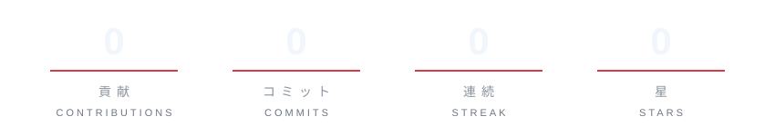
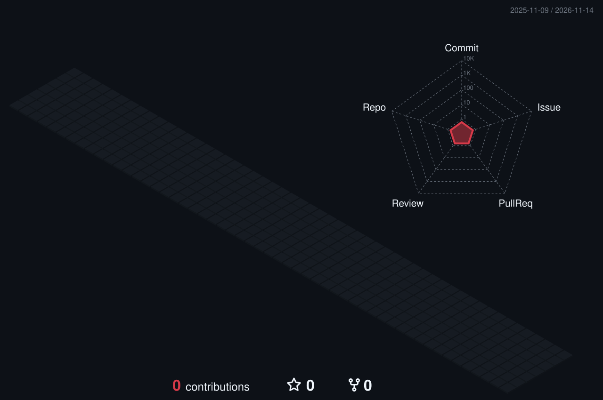

  

  
  
  

  

  
  

  

  

  

  

  
    art:
    <a href="https://twitter.com/gearous/status/1346784766608097280">GEAROUS</a> ·
    <a href="https://www.pixiv.net/en/artworks/98393335">へびお</a> ·
    <a href="https://www.pixiv.net/en/artworks/91429011">コユコム</a>
    · gif: Gun Smith Cats
  

