  

  

  
  
  
  

  
  
  
  

---

<h2 align="center">⚔️ 自己紹介</h2>

| | |
|---|---|
| 🐍 **Python** | when I am in a hurry |
| 🦀 **Rust** | when the compiler misses me |
| 💻 **Works** | on my machine |
| 🙏 **Method** | Ctrl+C, Ctrl+V, pray |

  
  

---

<h2 align="center">🗡️ 技術</h2>

  

  

---

<h2 align="center">📊 統計</h2>

  

  
  

  

  

---

  

  

  
    art:
    <a href="https://www.pixiv.net/en/artworks/92948762">わか</a> ·
    <a href="https://twitter.com/gearous/status/1346784766608097280">GEAROUS</a> ·
    <a href="https://www.pixiv.net/en/artworks/91429011">コユコム</a> ·
    <a href="https://twitter.com/FractalMagnolia/status/1426913902458130435">FractalMagnolia</a>
     
    gif: Kimi ni Todoke · Musaigen no Phantom World
  

  

